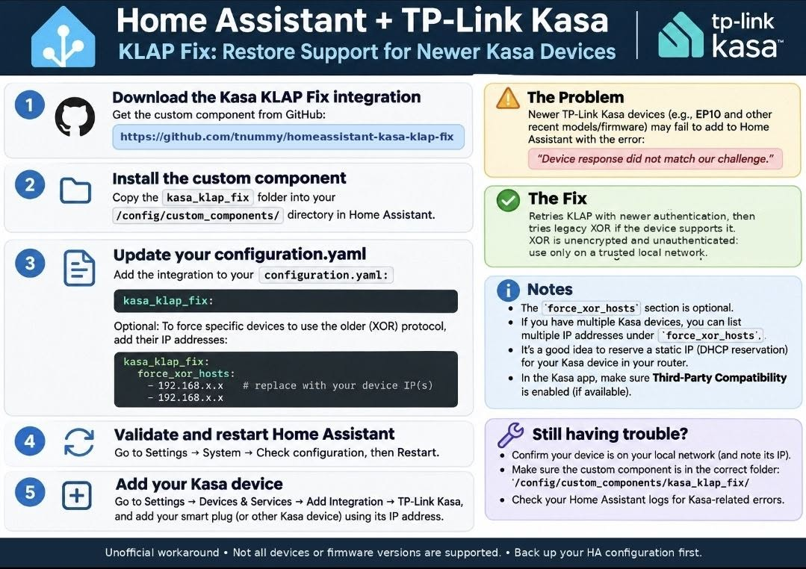

# homeassistant-kasa-klap-fix

A Home Assistant custom component that works around KLAP authentication failures
on Kasa devices — the `Device response did not match our challenge` /
`Credentials must be supplied` errors — despite entering correct TP-Link
credentials.

If some of your Kasa switches/plugs authenticate fine in Home Assistant but a
handful refuse no matter what you type, this is for you.

## The problem

Newer Kasa firmware breaks local authentication in a few different ways:

1. **Wrong KLAP hash version.** Legacy IOT-family devices that take a firmware
   update keep the old command set but switch to KLAP **v2** hashing.
   python-kasa hard-codes `"IOT.KLAP": (IotProtocol, KlapTransport)` (v1), so
   they fail. Upstream [PR #1731](https://github.com/python-kasa/python-kasa/pull/1731)
   fixes this only for devices reporting `login_version >= 2`; devices that
   signal with `new_klap: 1` are missed, because `EncryptionScheme` has no
   `new_klap` field and drops it during parsing
   ([#1740](https://github.com/python-kasa/python-kasa/issues/1740)).

2. **A credential the account password can't reproduce.** The newest factory
   firmware on some devices validates against a per-device secret provisioned by
   the cloud, not a hash of your username/password. No derivation of your
   credentials authenticates them
   ([#1752](https://github.com/python-kasa/python-kasa/issues/1752),
   [#1754](https://github.com/python-kasa/python-kasa/issues/1754),
   [home-assistant/core#160234](https://github.com/home-assistant/core/issues/160234)).
   Many of these same devices, however, still answer the **legacy XOR protocol**
   on port 9999, which needs no credentials at all.

## What this does

Patches python-kasa at runtime with two fallbacks, tried in order, only when a
normal KLAP handshake fails:

1. **KLAP v1 → v2.** Retries the handshake with v2 hashes before giving up.
2. **Unauthenticated XOR.** If KLAP still fails and the device answers port
   9999, switches that connection to `XorTransport` — no credentials needed.

The XOR decision is made per live connection, not from a list of IPs, so it
survives DHCP reassignment. Devices that authenticate normally are never
touched and take no extra round trip, which makes it safe on a mixed fleet.

## Install

1. Copy `custom_components/kasa_klap_fix/` into your Home Assistant
   `config/custom_components/` directory.
2. Add to `configuration.yaml`:

       kasa_klap_fix:

3. Restart Home Assistant.

That is the whole configuration. After restart you should see in the logs
(Settings → System → Logs):

    kasa_klap_fix loaded and patch applied (XOR forced for: no hosts)

and, when an affected device connects:

    KLAP authentication failed for <ip> but port 9999 is open;
    falling back to the unauthenticated XOR transport.

### Optional

`force_xor_hosts` skips the one doomed KLAP handshake per device at startup. Not
required — the automatic fallback handles it either way:

    kasa_klap_fix:
      force_xor_hosts:
        - 192.168.1.50

## Security note

XOR is unauthenticated and unencrypted. Any device reached via the XOR fallback
can be controlled by anything on your LAN. Port 9999 is already open on those
devices regardless of whether this component uses it, so this adds no new
network exposure — but it is a real property of the workaround. If you segment
your network, keep these devices on a trusted VLAN.

## Status

This is a **workaround pending an upstream fix**, not a permanent solution. It
monkey-patches python-kasa at runtime; the imports are written to tolerate the
class-location changes python-kasa has made across releases, but a larger
internal refactor upstream could still require an update here. Track the real
fix at:

- python-kasa [#1740](https://github.com/python-kasa/python-kasa/issues/1740),
  [#1752](https://github.com/python-kasa/python-kasa/issues/1752),
  [#1754](https://github.com/python-kasa/python-kasa/issues/1754)
- [PR #1731](https://github.com/python-kasa/python-kasa/pull/1731)
- home-assistant/core [#160234](https://github.com/home-assistant/core/issues/160234)

When the upstream fix lands, this component becomes a no-op (the fallback only
fires *after* a KLAP failure) and can be removed.

## License

MIT — see [LICENSE](LICENSE).
